<div align="center">

# 🔮 Daily Tarot Focus

**A cross-platform tarot & astrology companion built with Flutter and a Supabase backend.**

Daily card draws, AI-assisted tarot spreads, personalized horoscopes, zodiac compatibility, birth-chart insights and real-time planetary hours — wrapped in a polished, animated UI and available in 13 languages.

[](https://flutter.dev)
[](https://dart.dev)
[](https://supabase.com)
[](https://firebase.google.com)
[](#-platforms)

</div>

---

## Table of Contents

- [Overview](#-overview)
- [Screenshots](#-screenshots)
- [Features](#-features)
- [Tech Stack](#-tech-stack)
- [Architecture](#-architecture)
- [Project Structure](#-project-structure)
- [Backend (Supabase)](#-backend-supabase)
- [State Management & Data Flow](#-state-management--data-flow)
- [Internationalization](#-internationalization)
- [Assets](#-assets)
- [Getting Started](#-getting-started)
- [Environment Variables](#-environment-variables)
- [Platforms](#-platforms)

---

## 🌙 Overview

**Daily Tarot Focus** turns everyday reflection into a guided ritual. Users draw a card of the day, ask a focused question and receive a multi-card tarot spread interpreted through a chosen "reader" persona, explore their horoscope and zodiac compatibility, study their birth chart, and time their intentions around the classical **planetary hours** for their location.

The app is written in **Flutter** (single codebase for iOS & Android) and talks to a **Supabase** backend entirely through **Edge Functions** — the client never queries tables directly. Content generation (readings, horoscopes, compatibility) happens server-side, while the app focuses on a rich, animated presentation layer.

---

## 📸 Screenshots

### Explore — Tarot & Astrology home

The home hub ("Keşfet" / Explore) has two tabs. **Tarot** surfaces the current planetary hour, quick access to ask-a-question, spread building, the card of the day and the deck, plus a strip of recent daily-card history. **Astrology** surfaces the daily horoscope, compatibility and cosmic timing.

<p align="center">
  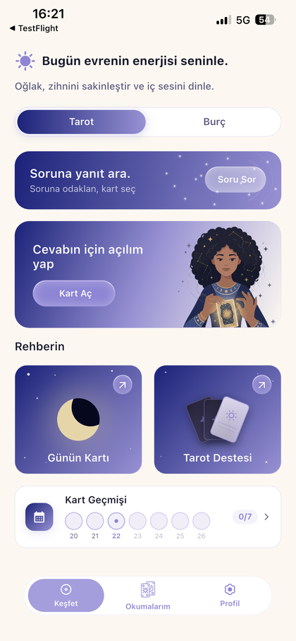
  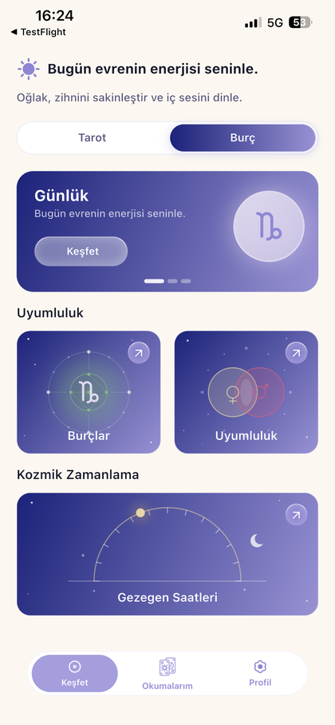
</p>

### Tarot reading flow (ask a question)

A guided, multi-step flow: pick a **reader** persona → choose a **spread** → type your **question** → **shuffle** → **pick your cards** → **reveal the spread** → the reading is **generated** server-side → read the **interpretation**, inspect each **card position**, and keep private **notes**.

<p align="center">
  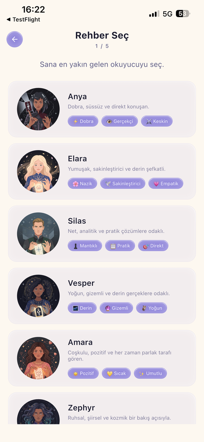
  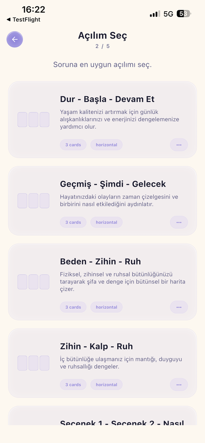
  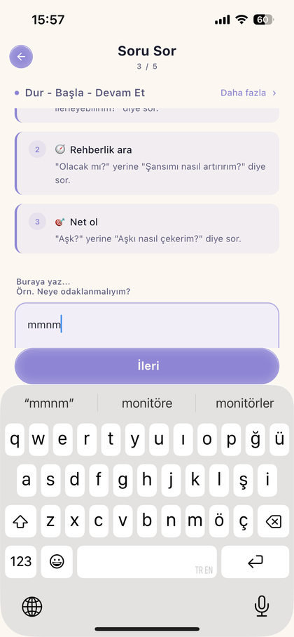
  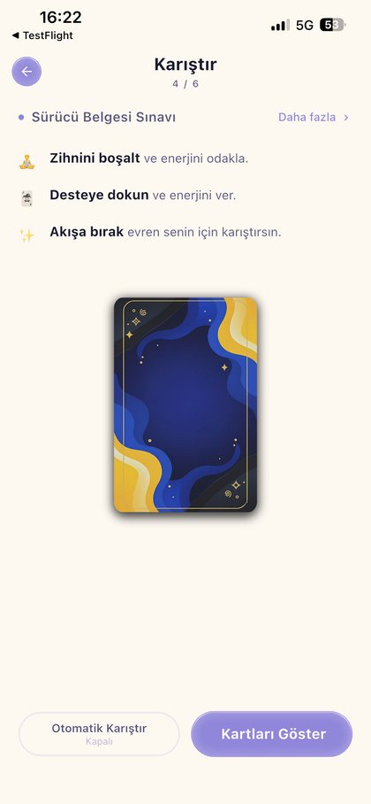
</p>
<p align="center">
  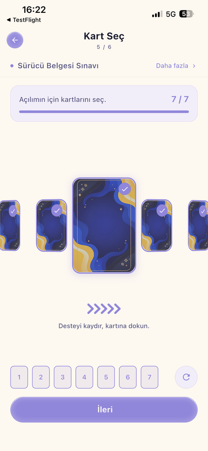
  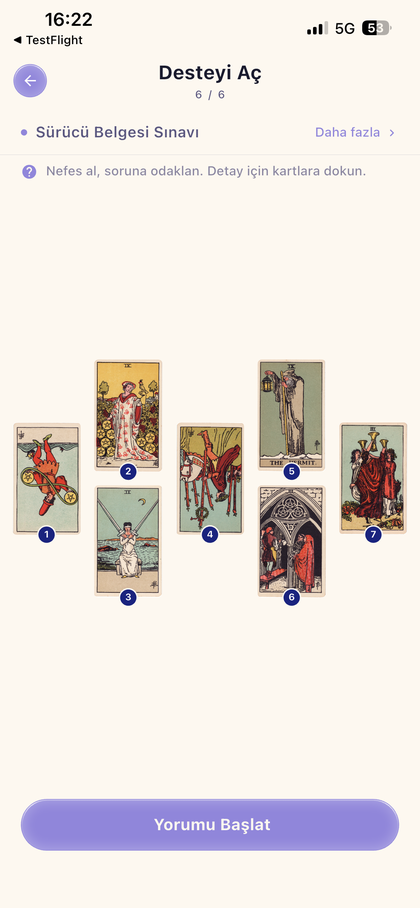
  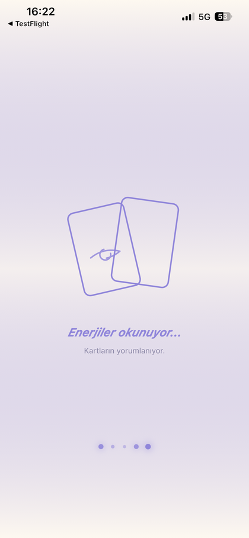
  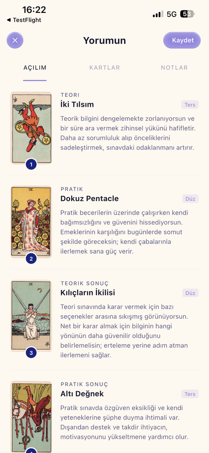
</p>
<p align="center">
  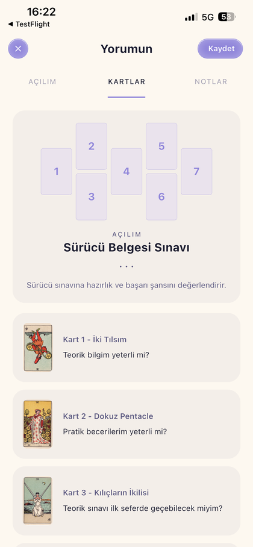
  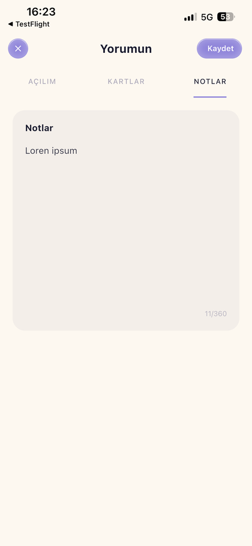
  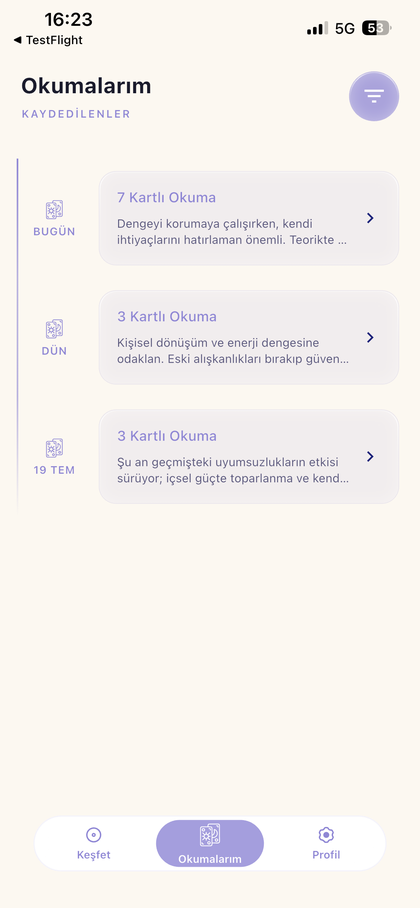
</p>

### Daily card & deck

Tap the animated deck to reveal the card of the day, read its full meaning, and browse the entire tarot deck (Major/Minor Arcana, filterable by suit).

<p align="center">
  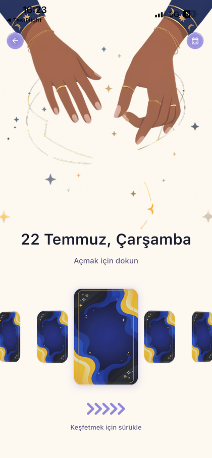
  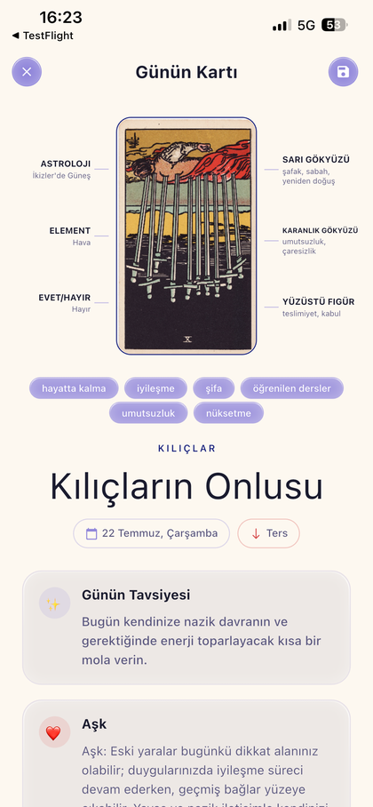
  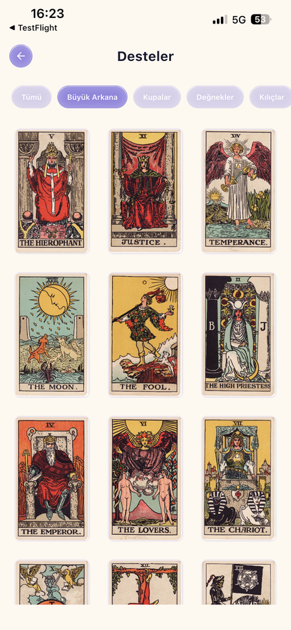
</p>

### Astrology — chart, compatibility & planetary hours

Explore your Sun / Moon / Rising signs and their traits, calculate zodiac compatibility with a partner (score breakdown across intimacy, trust, communication, emotions and values), and follow the live planetary hours for your location.

<p align="center">
  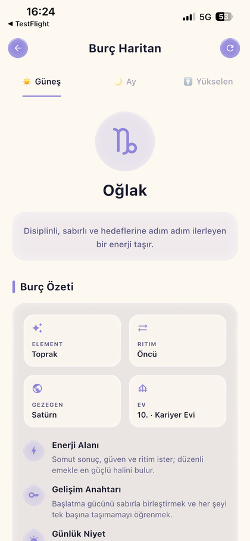
  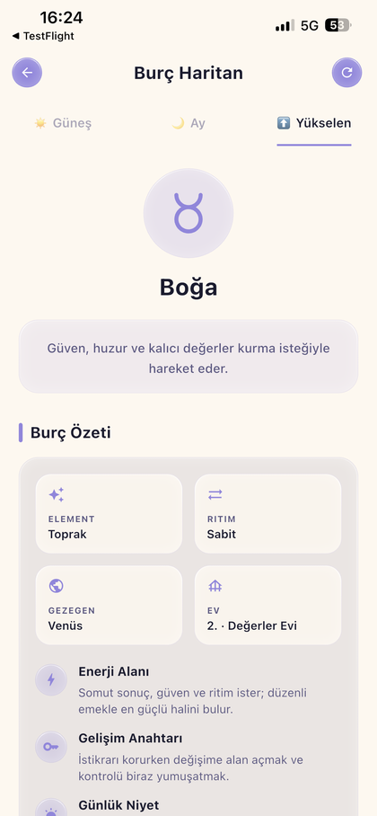
  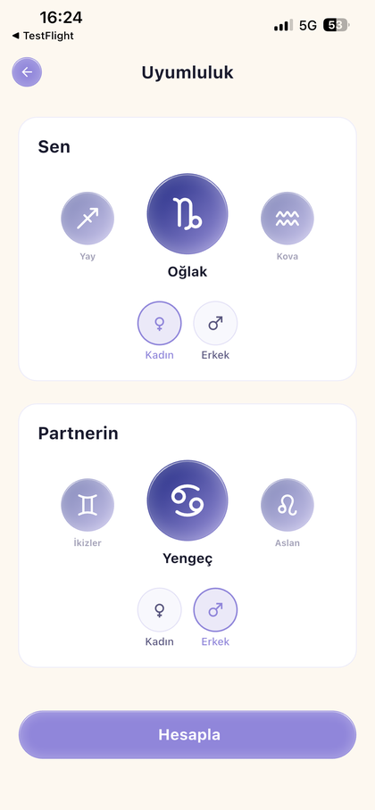
  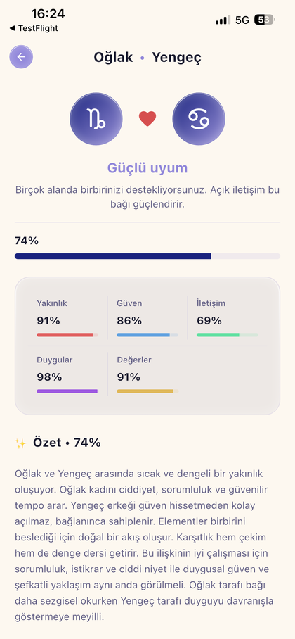
</p>
<p align="center">
  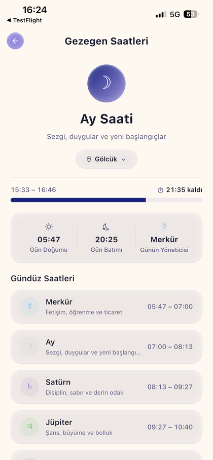
  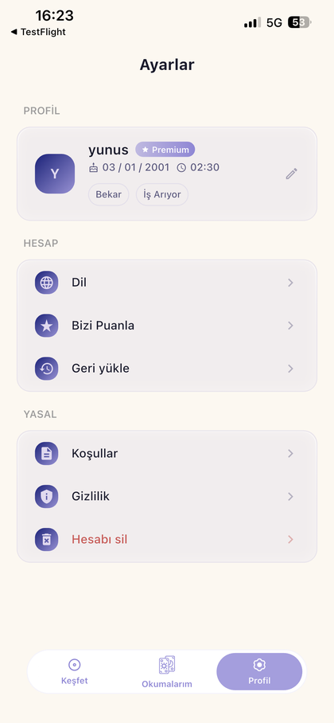
  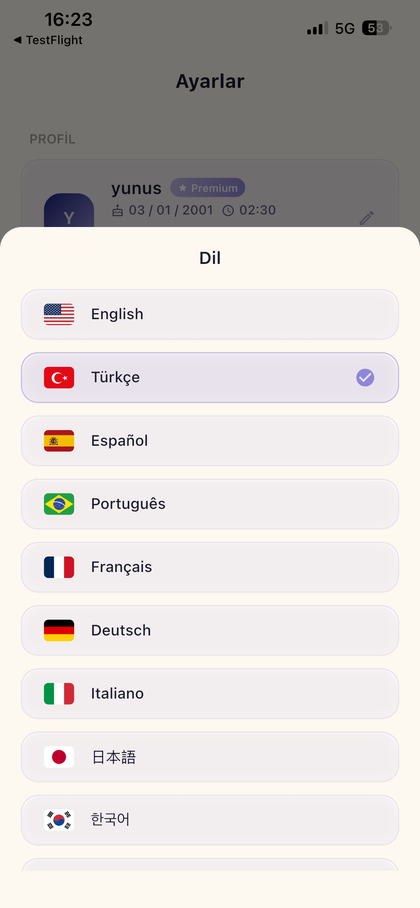
</p>

### Premium

<p align="center">
  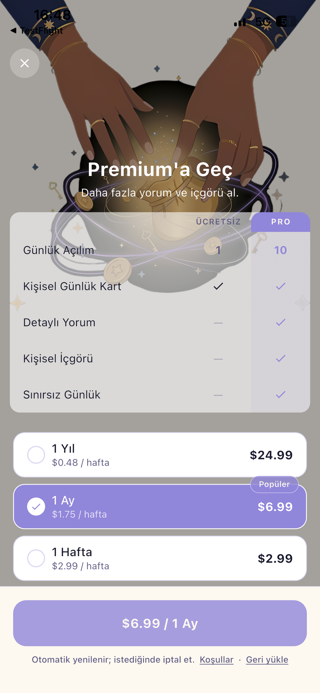
</p>

---

## ✨ Features

- **Card of the Day** — draw once per day with an animated reveal, full card meaning, daily advice and category-specific guidance (love, career, etc.); history is tracked on a calendar.
- **Guided tarot readings** — a step-by-step flow (reader → spread → question → shuffle → pick → reveal → interpret) that generates a personalized reading server-side.
- **Reader personas** — multiple "readers" (Anya, Elara, Silas, Vesper, Amara, Zephyr…) each with a distinct voice and tone that shapes the interpretation.
- **Spread library** — multiple spread layouts (e.g. Past–Present–Future, Mind–Heart–Soul, Body–Mind–Spirit and larger grids) with per-position meanings.
- **Saved readings** — save any reading, review it later by tab (interpretation / cards / notes), edit notes, and delete.
- **Deck browser** — the full tarot deck filterable by Major Arcana and the four suits (Cups, Wands, Pentacles, Swords) with detail pages.
- **Horoscope** — daily/periodic horoscope with general outlook, category breakdowns, stats, tips and critical days.
- **Zodiac compatibility** — pick two signs (with gender) and get a weighted match score across several dimensions plus a written summary.
- **Birth chart / Learn** — Sun, Moon and Rising signs with element, modality, ruling planet, house and personalized "energy" guidance based on birth date, time and location.
- **Planetary hours** — classical planetary-hour calculation for the user's geolocation, showing the current ruler, sunrise/sunset, and the full day/night hour table.
- **Onboarding & profile** — multi-step registration capturing relationship status, career and personal info to personalize content.
- **Subscription / paywall** — premium gating via RevenueCat, with a daily-usage limiter for free users.
- **Notifications** — remote push (FCM) and scheduled local notifications.
- **13 languages** — full localization (see [Internationalization](#-internationalization)).
- **Account management** — full account deletion via a dedicated Supabase Edge Function.

---

## 🛠 Tech Stack

| Layer | Technology |
|-------|-----------|
| **UI / Framework** | Flutter (Dart `^3.7.2`), Material Design |
| **Routing** | `go_router` |
| **State management** | Bloc + Cubit (via the `mobile_boilerplate` package) |
| **Dependency injection** | `get_it` |
| **Backend** | Supabase (Auth, Postgres, Edge Functions written in Deno/TypeScript) |
| **Auth** | Supabase Auth + Sign in with Apple / Google |
| **Push / crash / config** | Firebase Cloud Messaging, Crashlytics, Remote Config |
| **Payments** | RevenueCat |
| **Analytics / attribution** | Adjust |
| **Localization** | `easy_localization` (JSON per locale) |
| **Media / animation** | `lottie`, `flutter_svg`, `cached_network_image`, `flutter_spinkit`, `shimmer_animation` |
| **Responsive UI** | `flutter_screenutil` |
| **Time** | `timezone`, NTP-synced network time |
| **Lint** | `very_good_analysis` |

> The project depends on an internal shared package, **`mobile_boilerplate`** (referenced via a local `path:` dependency at `../mobile-boilerplate`), which provides cross-cutting infrastructure: auth, analytics, purchases, deep links, permissions, notifications, network time, color theming and various platform wrappers.

---

## 🏗 Architecture

The codebase follows a **feature-first, layered (Clean-ish) architecture**. Each feature is a self-contained slice split into three layers:

```
feature/
├── bloc/            # State management (Bloc/Cubit + events + states)
├── data/            # Data sources, repositories, cache services (implement domain contracts)
├── domain/          # Models, enums, request/response DTOs (framework-agnostic)
└── presentation/    # UI: pages, widgets, and page "helpers" (mixins + InheritedWidget scopes)
```

Key conventions:

- **Contracts vs. implementations** — abstract interfaces (`i_*` / `I*`) define contracts; concrete classes are prefixed `impl_` / `Impl*` and wired up in DI. This keeps features testable and swappable.
- **Repository pattern** — a `Repository` orchestrates one or more `RemoteDataSource`s and `CacheService`s; Blocs depend only on repositories.
- **Request/Response DTOs** — every backend call has an explicit `*_request_model.dart` and `*_response_model.dart` pair under `domain/models`, each with `toMap()` / `fromMap()`.
- **Page mixins + scopes** — complex pages keep their logic in a `*_page_mixin.dart` (controllers, handlers) exposed to the widget subtree via a `*_page_scope.dart` (an `InheritedWidget`), keeping `build` methods lean.
- **Edge-Function-only backend access** — the client never touches Supabase tables directly. All reads/writes go through named Edge Functions using a JWT-authenticated `secureInvoke` helper.

---

## 📁 Project Structure

```
daily-tarot-focus/
├── lib/
│   ├── main.dart                     # Entry point: env → bindings → core app → Firebase → DI → runApp
│   ├── tarot_app.dart                # Root MaterialApp (router, theme, localization)
│   ├── firebase_options.dart         # Generated Firebase config
│   │
│   ├── config/                       # App-wide setup & configuration
│   │   ├── app_config.dart           # TarotAppConfig (app-level constants)
│   │   ├── app_router.dart           # go_router configuration & guards
│   │   ├── app_routes.dart           # Centralized route path constants
│   │   ├── env.config.dart           # .env.keys loader (Supabase/RevenueCat/Adjust keys)
│   │   ├── restartable_app.dart      # Wrapper enabling full app restart
│   │   ├── setup_bindings.dart       # Early platform bindings
│   │   ├── setup_dependieces.dart    # get_it DI registration (single source of wiring)
│   │   └── setup_firebase.dart       # Firebase init (Crashlytics, Messaging, Remote Config)
│   │
│   ├── core/                         # Shared, feature-agnostic building blocks
│   │   ├── services/                 # e.g. image_preload_service
│   │   ├── util/                     # Colors, sizes, text styles, assets, routes,
│   │   │                             #   supabase_helper (secureInvoke), locale keys, codecs
│   │   └── widgets/                  # Reusable widgets (buttons, containers, app bar,
│   │                                 #   sheets, dialogs, cached images, detail content)
│   │
│   └── features/                     # Feature slices
│       ├── auth/                     # Onboarding, registration steps, profile, notifications, user repo
│       │   ├── bloc/                 #   register & edit-profile cubits
│       │   ├── data/                 #   auth service, user repository, local/remote notifications
│       │   ├── domain/models/        #   TarotUser, zodiac/career/relationship enums
│       │   └── presentation/         #   splash, onboarding, register step pages + widgets
│       │
│       ├── core/                     # App shell features
│       │   ├── home/                 #   home scaffold + bottom navbar
│       │   ├── settings/             #   settings page, delete-account popup
│       │   └── subscription/         #   paywall page, premium override service
│       │
│       ├── tarot/                    # The tarot domain (largest feature)
│       │   ├── bloc/tarot/           #   TarotBloc + events + states
│       │   ├── data/                 #   remote data source (Edge Functions), repository,
│       │   │                         #   cache service, daily-spread usage limiter
│       │   ├── domain/models/        #   request/response DTOs, enums (category, flow type),
│       │   │                         #   reading model
│       │   └── presentation/
│       │       ├── tarot_explore/    #   Explore/home tab (cards, banners, strips)
│       │       ├── tarot_reveal/     #   Card-of-the-day reveal + daily pick result
│       │       ├── tarot_deck/       #   Deck browser + card detail
│       │       ├── tarot_spread/     #   Multi-step question→spread→pick→answer flow
│       │       ├── tarot_reading/    #   Reading detail (interpretation/cards/notes tabs)
│       │       └── tarot_daily/      #   Daily calendar + day detail
│       │
│       ├── zodiac/                   # Astrology domain
│       │   ├── bloc/zodiac/          #   ZodiacBloc + events + states
│       │   ├── data/                 #   remote data source, repository, cache service
│       │   ├── domain/models/        #   horoscope & compatibility DTOs, period enum
│       │   └── presentation/
│       │       ├── zodiac_learn/     #   Birth chart / Sun-Moon-Rising, astrology helpers
│       │       ├── zodiac_horoscope/ #   Horoscope page + cards
│       │       └── zodiac_compatibility/  # Compatibility input + result
│       │
│       └── planetary_hours/          # Classical planetary-hour calculator
│           ├── data/                 #   location service
│           ├── domain/               #   hour calculator + activity model
│           └── presentation/         #   page + current-hour card + hour list
│
├── assets/
│   ├── svg/                          # Icons: zodiac glyphs, tarot, moon, sparkles, etc.
│   ├── json/                         # Lottie animations (e.g. shining_stars)
│   ├── translations/                 # 13 locale JSON files
│   └── *.webp                        # Bundled tarot card art
│
├── supabase/
│   └── functions/
│       └── delete-user/index.ts      # Edge Function: full user data + auth deletion
│
├── docs/screenshots/                 # README screenshots
├── ios/ · android/ · macos/ ...      # Platform runners
├── pubspec.yaml                      # Dependencies & asset declarations
└── .env.keys                         # Secrets (gitignored) — see Environment Variables
```

---

## ☁️ Backend (Supabase)

The backend is **Supabase** and is accessed **exclusively through Edge Functions** — there are no direct table queries from the client. Every request is authenticated with the user's JWT via a small extension helper:

```dart
// lib/core/util/supabase_helper.dart
extension SupabaseHelper on SupabaseClient {
  Future<FailureOr<FunctionResponse>> secureInvoke({
    required String route,
    required AuthSession session,
    Object? body,
    HttpMethod method = HttpMethod.get,
  }) async {
    if (session.idToken.isEmpty) return left(const UnknownFailure());
    return right(await functions.invoke(
      route,
      method: method,
      headers: {'authorization': 'Bearer ${session.idToken}'},
      body: body,
    ));
  }
}
```

### Edge Functions

Route names live in `lib/core/util/tarot_routes.dart`:

| Function | Method | Purpose |
|----------|--------|---------|
| `get-user` / `update-user` / `delete-user` | GET / — / POST | User profile CRUD & account deletion |
| `sync-premium` | — | Reconcile premium/subscription state |
| `get-daily-cards` | GET | Fetch the user's daily-card history |
| `save-daily-card` | POST | Record today's drawn card |
| `generate-daily-pick` | POST | Generate the card-of-the-day pick |
| `get-all-cards` | POST | Fetch the full deck (locale-aware) |
| `get-tarot-spreads` | POST | Fetch available spread layouts |
| `get-readers` | POST | Fetch reader personas |
| `ask-question` | POST | Generate a reading for a question + spread |
| `save-reading` | POST | Persist a reading |
| `get-saved-readings` | GET | List saved readings |
| `update-reading-note` | PATCH | Edit a saved reading's note |
| `delete-reading` | DELETE | Remove a saved reading |
| `generate-horoscope` | POST | Generate a horoscope |
| `generate-compatibility` | POST | Compute zodiac compatibility |

> The Method column reflects how the client calls each route (`HttpMethod` in `impl_*_remote_data_source.dart`). Content-generating functions (`ask-question`, `generate-horoscope`, `generate-compatibility`, `generate-daily-pick`) run the interpretation logic server-side.

### Included Edge Function: `delete-user`

The repository ships the `delete-user` function (`supabase/functions/delete-user/index.ts`). It authenticates the caller with their JWT, then deletes their rows from every user-owned table before removing the auth user itself:

```ts
const USER_TABLES = [
  { table: "daily_tarot_records", column: "user_id" },
  { table: "saved_readings",      column: "user_id" },
  { table: "users",               column: "user_id" },
];
```

Deploy it with:

```bash
supabase functions deploy delete-user --project-ref <your-project-ref>
```

### Data model (inferred)

From the delete function and the DTOs, the core user-owned tables are:

- **`users`** — profile (zodiac, relationship, career, birth data, premium flag).
- **`daily_tarot_records`** — per-day card draws.
- **`saved_readings`** — persisted readings with notes.

Reference data (cards, spreads, readers) is served through the corresponding `get-*` functions.

---

## 🔄 State Management & Data Flow

```
UI (Page + *_page_scope)
      │  user intent
      ▼
Bloc / Cubit  ──►  Repository  ──►  RemoteDataSource ──► secureInvoke() ──► Supabase Edge Function
      ▲                 │
      │                 └────────►  CacheService (in-memory / persisted)
      └── emits State ──► UI rebuilds
```

- **Blocs**: `TarotBloc` and `ZodiacBloc` are registered as lazy singletons; `AuthCubit`, `RegisterCubit`, `PurchasesBloc`, etc. as factories.
- **Repositories** decide between cache and network; **cache services** (`ImplTarotCacheService`, `ImplZodiacCacheService`) avoid redundant Edge Function calls.
- **DI**: everything is wired in `lib/config/setup_dependieces.dart` using `get_it`.
- **Routing**: declared in `app_router.dart` with path constants in `app_routes.dart`; routes are grouped into public / register / authenticated sets.

---

## 🌍 Internationalization

Localization uses **`easy_localization`** with one JSON file per locale in `assets/translations/`. **13 languages** are supported:

🇬🇧 English · 🇹🇷 Türkçe · 🇪🇸 Español · 🇵🇹 Português · 🇫🇷 Français · 🇩🇪 Deutsch · 🇮🇹 Italiano · 🇷🇺 Русский · 🇯🇵 日本語 · 🇰🇷 한국어 · 🇹🇭 ไทย · 🇨🇳 简体中文 · 🇹🇼 繁體中文

Users can switch language at runtime from **Settings → Language**.

---

## 🎨 Assets

| Path | Contents |
|------|----------|
| `assets/svg/` | Vector icons — zodiac glyphs, tarot, moon & stars, sparkles, crown, and feature icons |
| `assets/json/` | Lottie animations (e.g. `shining_stars.json`) |
| `assets/*.webp` | Bundled tarot card artwork |
| `assets/translations/` | 13 locale JSON files |

Assets are declared in `pubspec.yaml` under `flutter/assets`.

> **Note:** the raw screenshot PNGs (`IMG_*.PNG`) currently live in `assets/`, which is bundled into the app via the `assets/` glob. Consider moving them out of `assets/` so they aren't shipped inside the app binary. The optimized copies used by this README already live in `docs/screenshots/`.

---

## 🚀 Getting Started

### Prerequisites

- **Flutter** SDK `3.7+` (Dart `^3.7.2`) — stable channel
- Xcode (iOS) and/or Android Studio + SDK (Android)
- A **Supabase** project with the Edge Functions listed above deployed
- Firebase project (`google-services.json` / `GoogleService-Info.plist` + `firebase_options.dart`)
- The internal **`mobile_boilerplate`** package available at `../mobile-boilerplate` (sibling directory)

### Setup

```bash
# 1. Clone (with the sibling boilerplate package present alongside it)
git clone https://github.com/balkayunus7/daily-tarot-focus.git
cd daily-tarot-focus

# 2. Create your secrets file (see Environment Variables below)
touch .env.keys   # then fill in the values

# 3. Install dependencies
flutter pub get

# 4. Run
flutter run
```

> The project expects `../mobile-boilerplate` to exist relative to the repo root (see `pubspec.yaml`). Make sure that package is checked out next to this one.

---

## 🔑 Environment Variables

Secrets are loaded at startup from **`.env.keys`** (via `flutter_dotenv`, declared as an asset and **gitignored**). Required keys (`lib/config/env.config.dart`):

```dotenv
SUPABASE_URL=https://<your-project>.supabase.co
SUPABASE_ANON_KEY=<your-anon-key>
REVENUECAT_API_KEY=<your-revenuecat-key>
ADJUST_SDK_KEY=<your-adjust-key>
```

The app throws on startup if any of these are missing.

---

## 📱 Platforms

Primary targets are **iOS** and **Android**. The repository also contains Flutter desktop/web runners (`macos/`, `linux/`, `windows/`, `web/`) generated by Flutter, but the app is designed and tested for mobile.

---

<div align="center">

Built with Flutter 💜 · Backed by Supabase

</div>
